# Arquitectura — Simulador de Trabajo Mecánico

Documento técnico que describe cómo está construida la app: navegación, pantallas, componentes, estado global (Redux), utilidades de física y los flujos principales.

> Los diagramas usan **Mermaid**. Se ven renderizados en GitHub, GitLab y en VS Code (con la extensión *Markdown Preview Mermaid Support*).

---

## 1. Resumen

App educativa de **Física 1** que simula el **trabajo mecánico**:

$$W = |F| \cdot d \cdot \cos(\theta)$$

El usuario ingresa **fuerza (N)**, **ángulo (°)**, **distancia (m)** y **masa (kg)**. La app calcula las componentes de la fuerza, el trabajo, la aceleración y la cinemática del cuerpo, y lo muestra en tarjetas de resultados, un gráfico vectorial SVG y una animación del desplazamiento con leyenda en tiempo real. Una segunda pestaña ofrece una **wiki** de conceptos en forma de tarjetas.

Funciona en **Android, iOS (Expo Go)** y **Web**.

---

## 2. Stack tecnológico

| Capa | Tecnología | Uso en la app |
|---|---|---|
| Plataforma | Expo SDK 55 · React Native 0.83 · React 19.2 | Base multiplataforma |
| Navegación | Expo Router (rutas por archivos) | `Stack` raíz + `Tabs` inferiores |
| Estado | Redux Toolkit + React-Redux | Slices `theme`, `simulator`, `wiki` |
| UI | React Native Paper (Material Design 3) | Tarjetas, inputs, botones, Appbar, tema |
| Gráficos | react-native-svg | Gráfico vectorial de fuerza |
| Animación | API `Animated` de React Native | Bienvenida y desplazamiento del bloque |
| Íconos | `@expo/vector-icons` (MaterialCommunityIcons) | Tabs, tarjetas, flechas |
| Web | react-native-web | Versión navegador |
| Build | EAS Build (`eas.json`) | APK / AAB en la nube |

---

## 3. Estructura de carpetas

```text
simulador-proyectoFisica/
├── app/                        # RUTAS (Expo Router): solo archivos delgados
│   ├── _layout.jsx             # Layout raíz: Redux + Paper + Stack
│   ├── index.jsx               # "/"  → WelcomeScreen
│   └── (tabs)/
│       ├── _layout.jsx         # Barra de pestañas flotante
│       ├── simulator.jsx       # "/simulator" → SimulatorScreen
│       └── wiki.jsx            # "/wiki"      → WikiScreen
│
├── modules/                    # FUNCIONALIDADES (feature modules)
│   ├── home/
│   │   ├── screens/            # WelcomeScreen, SimulatorScreen
│   │   ├── components/         # WelcomeCard, ResultCard, ForceVectorChart, PhysicsAnimation
│   │   └── stores/             # simulatorSlice.js
│   └── wiki/
│       ├── screens/            # WikiScreen
│       ├── components/         # WikiCard, ProgressBar
│       └── stores/             # wikiSlice.js
│
├── src/                        # CÓDIGO COMPARTIDO
│   ├── components/Header.jsx   # Appbar con botón de modo oscuro
│   ├── stores/index.js         # configureStore (combina los slices)
│   ├── stores/themeSlice.js    # Modo claro / oscuro
│   ├── styles/theme.js         # Temas MD3 verdes (light / dark)
│   └── utils/physicsCalculations.js   # Funciones puras de física
│
├── data/wikiData.json          # Contenido de la wiki
├── assets/                     # Íconos y splash
├── app.json                    # Configuración Expo (nombre, scheme, íconos…)
└── eas.json                    # Perfiles de build en la nube
```

> `App.js` e `index.js` son restos de la plantilla inicial y **no se usan**: el punto de entrada es `expo-router/entry` (`"main"` en `package.json`).

**Regla de capas:** `app/` solo enruta → `modules/` contiene pantallas y lógica de cada funcionalidad → `src/` contiene lo reutilizable por todas.

---

## 4. Vista general por capas

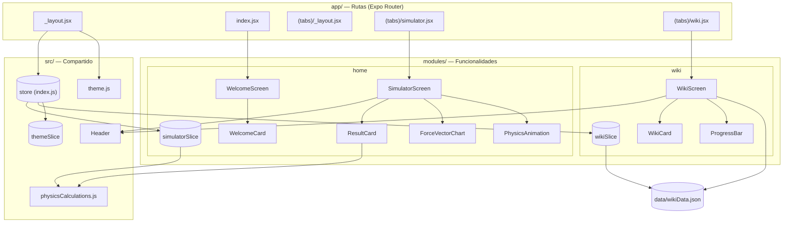

---

## 5. Navegación

La navegación se define **por archivos** dentro de `app/`. Hay un `Stack` raíz (sin encabezados) que contiene la pantalla de bienvenida y el grupo de pestañas `(tabs)`. Los paréntesis indican un **grupo**: no aparece en la URL.

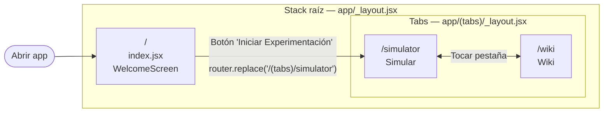

- `router.replace` **reemplaza** la bienvenida en el historial: al presionar "atrás" desde las pestañas no se regresa a ella.
- La barra de pestañas es **flotante** (`position: 'absolute'`, bordes redondeados), por lo que cada pantalla deja un `paddingBottom` (~90–110 px) para que el contenido no quede oculto.

| Ruta | Archivo | Pantalla | Ícono pestaña |
|---|---|---|---|
| `/` | `app/index.jsx` | `WelcomeScreen` | — |
| `/simulator` | `app/(tabs)/simulator.jsx` | `SimulatorScreen` | `calculator` |
| `/wiki` | `app/(tabs)/wiki.jsx` | `WikiScreen` | `book-open-variant` |

---

## 6. Árbol de proveedores (layout raíz)

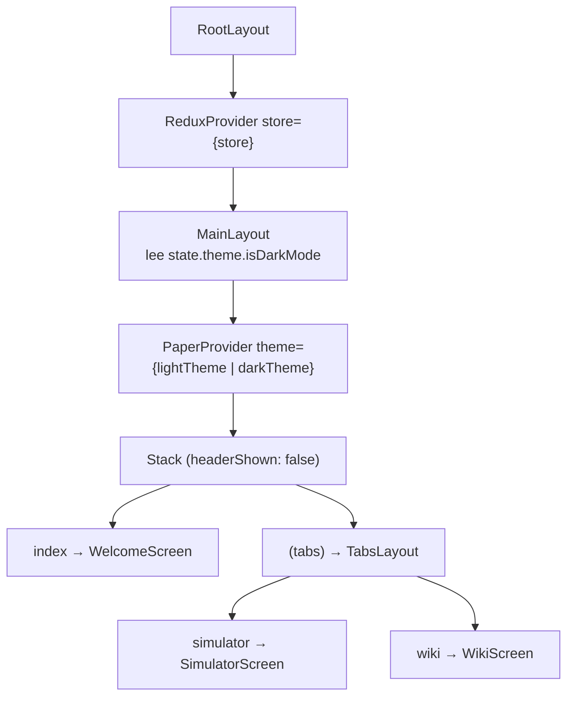

`MainLayout` está separado de `RootLayout` porque necesita `useSelector`, y ese hook solo funciona **dentro** del `ReduxProvider`.

---

## 7. Pantallas y componentes

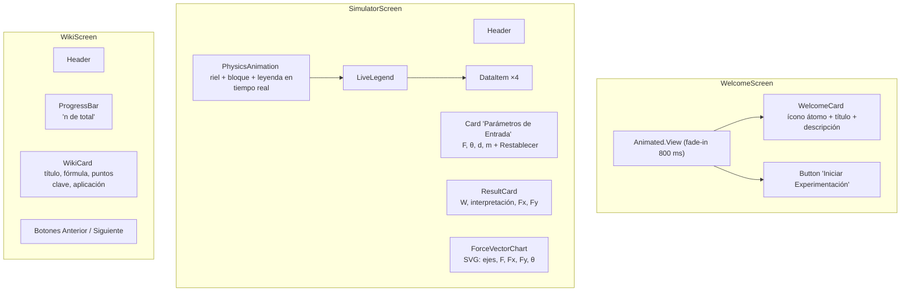

### Responsabilidad de cada componente

| Componente | Ubicación | Props | Responsabilidad |
|---|---|---|---|
| `Header` | `src/components` | `title` | Appbar con título y botón sol/luna que despacha `toggleTheme()` |
| `WelcomeCard` | `home/components` | — | Presentación visual de la app |
| `ResultCard` | `home/components` | `work, fx, fy, angle` | Muestra W, Fx, Fy y la interpretación (positivo / nulo / negativo) con su color |
| `ForceVectorChart` | `home/components` | `force, angle, fx, fy` | Dibuja en SVG (300×200) el vector F y sus componentes. La longitud se limita entre 40 y 180 px |
| `PhysicsAnimation` | `home/components` | `distance, mass, angle, acceleration, kinematics` | Anima el bloque sobre un riel a escala y controla la leyenda en tiempo real |
| `LiveLegend` | dentro de `PhysicsAnimation` | `progress, isRunning, acceleration, kinematics, distance` | Muestra a, t, x(t), v(t) y el estado del movimiento |
| `WikiCard` | `wiki/components` | `item` | Renderiza un concepto de `wikiData.json` |
| `ProgressBar` | `wiki/components` | `currentIndex, total` | Barra de progreso de lectura |

**Patrón:** las **pantallas** se conectan a Redux (`useSelector` / `useDispatch`); los **componentes** son presentacionales y reciben todo por props (excepto `Header`, que maneja el tema).

---

## 8. Estado global (Redux Toolkit)

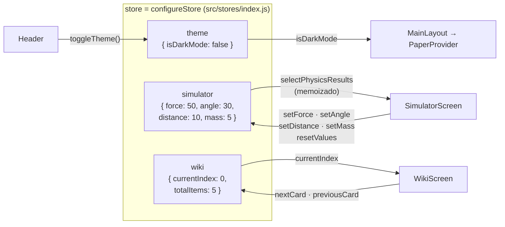

### Slices

| Slice | Archivo | Estado | Acciones |
|---|---|---|---|
| `theme` | `src/stores/themeSlice.js` | `isDarkMode` | `toggleTheme`, `setDarkMode` |
| `simulator` | `modules/home/stores/simulatorSlice.js` | `force`, `angle`, `distance`, `mass` | `setForce`, `setAngle`, `setDistance`, `setMass`, `resetValues` |
| `wiki` | `modules/wiki/stores/wikiSlice.js` | `currentIndex`, `totalItems` | `nextCard`, `previousCard`, `setCardIndex` (validan los límites) |

### Principio clave: el store guarda solo **entradas**

El slice `simulator` almacena únicamente los 4 valores que escribe el usuario. Todo lo derivado se calcula en el selector **`selectPhysicsResults`**, creado con `createSelector` (memoización): solo recalcula cuando cambia `state.simulator`, y devuelve el **mismo objeto** si nada cambió, evitando renders innecesarios.

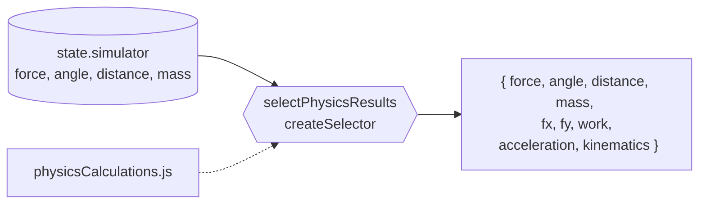

---

## 9. Utilidades de física (`src/utils/physicsCalculations.js`)

Funciones **puras** (sin React ni Redux), fáciles de probar y reutilizar.

| Función | Fórmula | Devuelve |
|---|---|---|
| `degToRad(deg)` | `deg · π / 180` | radianes |
| `calculateFx(F, θ)` | `Fx = F · cos θ` | componente paralela (N) |
| `calculateFy(F, θ)` | `Fy = F · sin θ` | componente perpendicular (N) |
| `calculateWork(F, d, θ)` | `W = Fx · d` | trabajo (J) |
| `getWorkInterpretation(θ, W)` | clasifica el signo de W | `{ type, description, color }` |
| `calculateAcceleration(F, θ, m)` | `a = Fx / m` (2.ª ley de Newton) | m/s² (0 si m ≤ 0) |
| `calculateKinematics(W, m, d)` | `v = √(2·|W| / m)`, `t = 2d / v` | `{ mode, initialVelocity, finalVelocity, time }` |

### Clasificación del trabajo y modo de movimiento

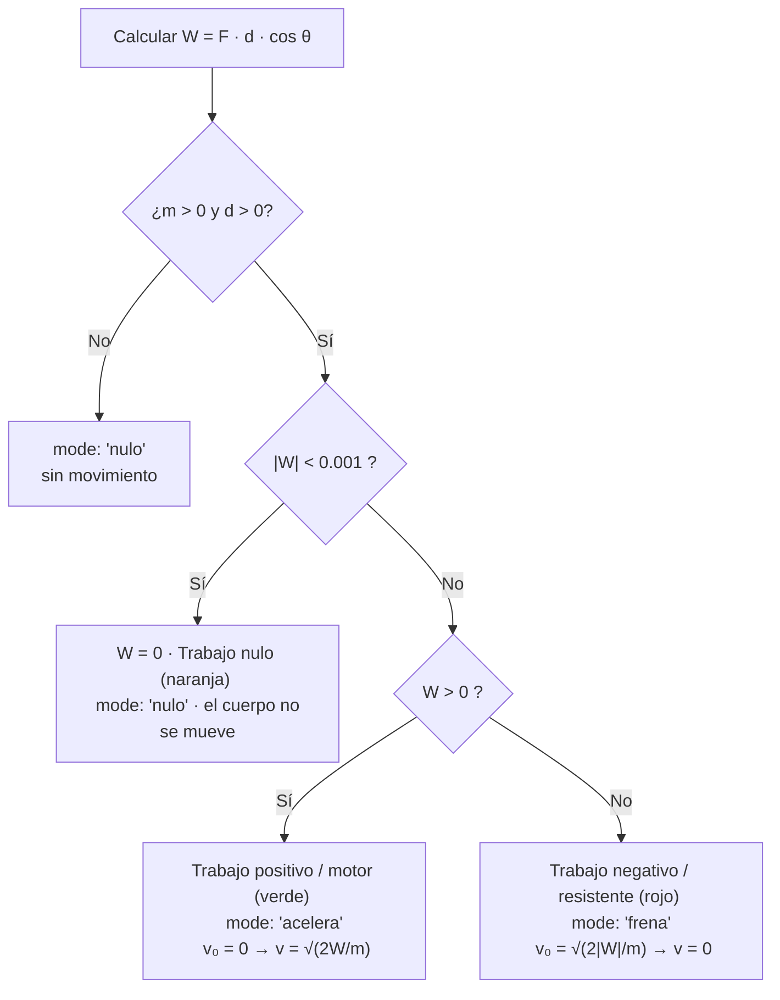

Base física — **teorema trabajo-energía** con aceleración constante:

- `W = ΔEc = ½·m·v² − ½·m·v₀²`
- `x(t) = v₀·t + ½·a·t²`
- `v(t) = v₀ + a·t`

---

## 10. Flujo de datos del simulador

Qué ocurre cuando el usuario cambia un valor (por ejemplo, la fuerza):

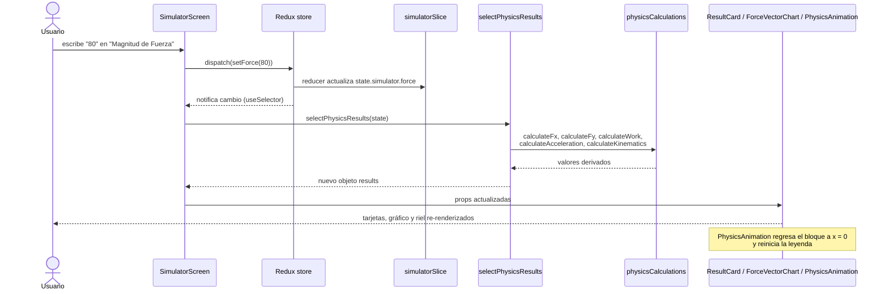

---

## 11. Workflow de la animación de desplazamiento

### Escalas

- **Espacial:** el riel completo representa **50 m**. `travelPx = min(d, 50) / 50 × (anchoRiel − 50 px)`. El ancho del riel se mide con `onLayout`.
- **Temporal:** la duración es el **tiempo físico real** `t`, limitada a **0.5 s – 6 s** para que sea visible. Si se ajusta, se avisa ("acelerada" / "en cámara lenta").
- **Curva (easing):** representa aceleración constante:
  - `acelera` → `Easing.in(Easing.quad)` (x ∝ t²)
  - `frena` → `Easing.out(Easing.quad)` (desacelera hasta detenerse)

### Secuencia al presionar "Ejecutar Animación"

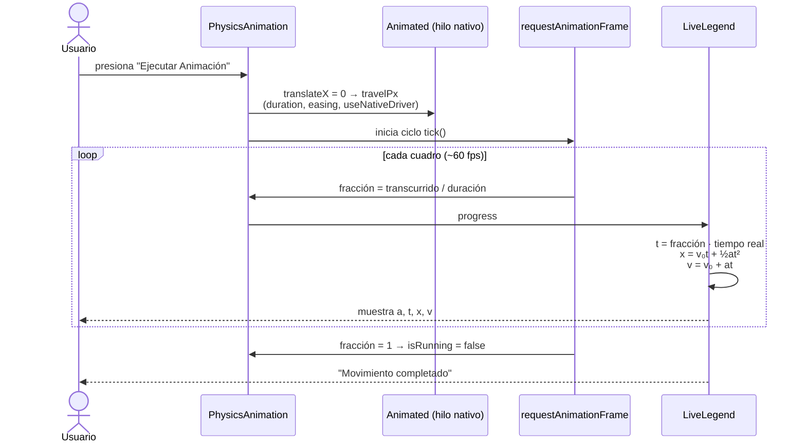

### Estados de la animación

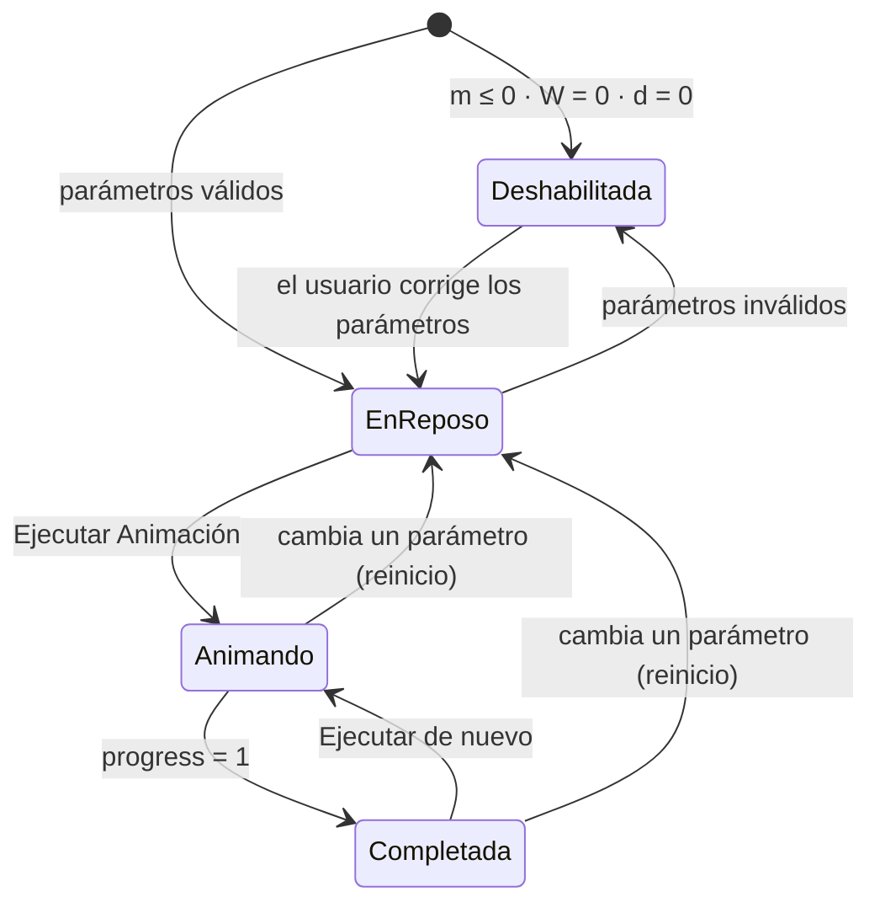

> El bloque se mueve con el **driver nativo** (fluido aunque el hilo de JS esté ocupado); la leyenda se actualiza en JS con `requestAnimationFrame`, sincronizada por tiempo transcurrido. Al desmontar o cambiar parámetros, el ciclo se cancela con `cancelAnimationFrame`.

---

## 12. Tema claro / oscuro

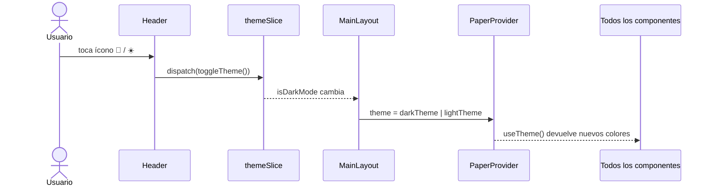

Los temas (`src/styles/theme.js`) extienden `MD3LightTheme` / `MD3DarkTheme` con una paleta **verde**. Por eso los componentes leen los colores con `useTheme()` en lugar de escribirlos fijos. Las únicas excepciones son los colores semánticos de la interpretación del trabajo (verde / naranja / rojo) y algunos trazos grises del SVG.

---

## 13. Flujo de la wiki

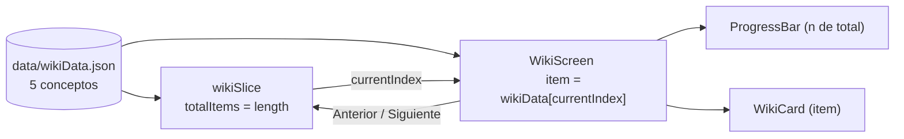

Estructura de cada concepto:

```json
{
  "id": "concept_1",
  "title": "Trabajo Mecánico (W)",
  "subtitle": "Definición y Producto Escalar",
  "formula": "W = |F| · |d| · cos(θ)",
  "description": "…",
  "keyPoints": ["…", "…"],
  "application": "…"
}
```

Conceptos actuales: Trabajo Mecánico · Componentes de la Fuerza · Leyes de Newton · Fuerza Normal y Rozamiento · Teorema del Trabajo y la Energía.

---

## 14. Diseño responsivo

`SimulatorScreen` decide el layout con `useWindowDimensions`:

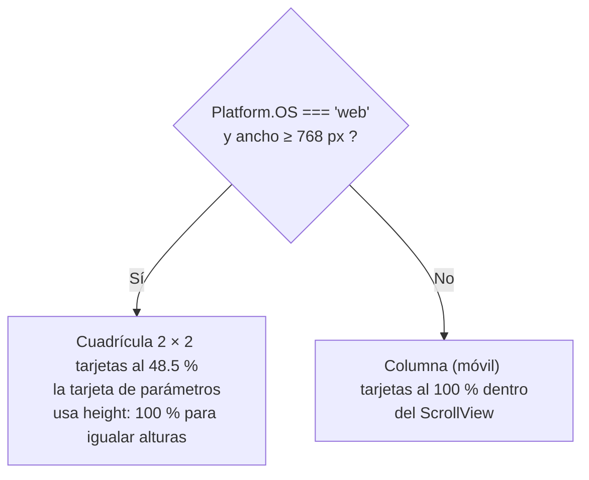

> En móvil **no** se aplica `height: '100%'` a la tarjeta de parámetros: dentro de un `ScrollView` se resolvía contra la altura visible y empujaba las demás tarjetas fuera de la pantalla.

---

## 15. Ejecución y build

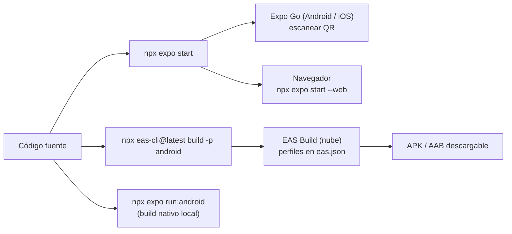

| Comando | Para qué |
|---|---|
| `npx expo start` | Servidor de desarrollo (Expo Go o web) |
| `npx expo start --web` | Abrir en el navegador |
| `npx expo run:android` | Build nativo local (genera `android/`) |
| `npx eas-cli@latest build -p android --profile preview` | Build en la nube |
| `npx expo-doctor` | Diagnóstico de dependencias y configuración |

Notas:
- `android/` e `ios/` se **generan** automáticamente (Continuous Native Generation) y están en `.gitignore`. La configuración nativa va en `app.json`.
- En Windows, los builds locales pueden fallar si la ruta del proyecto es muy larga (límite de 260 caracteres de `ninja`). Usa una ruta corta o EAS Build.
- Perfiles en `eas.json`: `development` (dev client), `preview` (distribución interna), `production` (versión autoincremental).

---

## 16. Cómo extender la app

| Quiero… | Pasos |
|---|---|
| **Agregar un concepto a la wiki** | Añadir un objeto a `data/wikiData.json`. `totalItems` y la barra de progreso se actualizan solos. |
| **Agregar un parámetro al simulador** | 1) Estado inicial + acción en `simulatorSlice` · 2) Cálculo puro en `physicsCalculations.js` · 3) Incluirlo en `selectPhysicsResults` · 4) `TextInput` en `SimulatorScreen` · 5) Pasarlo por props al componente que lo use. |
| **Agregar una pestaña** | Crear `app/(tabs)/nueva.jsx` (ruta delgada) + `<Tabs.Screen name="nueva">` en `app/(tabs)/_layout.jsx` + la pantalla en `modules/<feature>/screens/`. |
| **Agregar un slice** | Crearlo en `modules/<feature>/stores/` y registrarlo en `src/stores/index.js`. |
| **Cambiar colores** | Editar `src/styles/theme.js` (ambos temas). |

**Convenciones:** textos de la interfaz y comentarios en **español**; componentes de **react-native-paper**; colores desde `useTheme()`; íconos de `@expo/vector-icons`; importaciones con rutas relativas.
